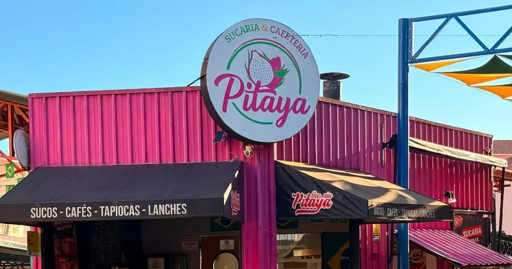

# Sucaria Pitaya

Site institucional da **Sucaria Pitaya**, sucaria e cafeteria no Centro de Sorocaba (SP).

**[Ver o site no ar](https://sucariapitaya.vercel.app)**



## Sobre o projeto

A ideia era apresentar a loja com a mesma cor e o mesmo sabor de quem entra nela, e levar a pessoa até o pedido sem complicação. Não há carrinho: o pedido segue pelo WhatsApp, iFood ou 99Food.

## Destaques

- **Abertura em três bebidas:** um movimento de rolagem troca o cenário inteiro, com os copos girando em torno da curva da página. O layout nasceu no Figma.
- **Barra de vidro:** refração calculada em tempo real e cores que se adaptam ao fundo. Em navegadores sem suporte, vira vidro fosco.
- **Sucos:** passeio horizontal em que o fundo acompanha a cor de cada fruta.
- **Favoritos:** a palavra vira uma janela e cada prato ocupa a tela.
- **Horário ao vivo:** mostra se a loja está aberta, no fuso de Sorocaba.

## Cuidados

- **Responsivo:** pensado para computador e celular.
- **Acessibilidade:** navegação por teclado, atalho para o conteúdo, textos alternativos e respeito à preferência por menos movimento.
- **Privacidade:** sem cookies próprios, rastreamento ou formulários. Fontes e bibliotecas ficam no próprio projeto, e o mapa só carrega com um clique.
- **Desempenho:** imagens em WebP com carregamento sob demanda.

## Tecnologias

HTML, CSS e JavaScript puros, [GSAP](https://gsap.com) com ScrollTrigger, filtros SVG e Canvas, Figma e Vercel.

## Como rodar

Não precisa instalar nada.

```bash
git clone https://github.com/giovannacmc/sucaria-pitaya.git
```

Depois, abra o `index.html` no navegador ou use a extensão Live Server do VS Code.

## Estrutura

```text
├── index.html          página principal
├── privacidade.html    política de privacidade
├── style.css           estilos
├── app.js              animações e interações
├── fonts.css           declaração das fontes
├── fonts/              fontes do projeto
├── lib/                GSAP e ScrollTrigger
└── img/                imagens
```

## Autoria

Projeto de [giovannacmc](https://github.com/giovannacmc).

## Direitos

A marca, as fotos e os textos são da Sucaria Pitaya e não podem ser reutilizados sem autorização. Os nomes iFood, 99 e Nutella pertencem aos seus donos. Fontes sob licença SIL Open Font License e GSAP sob a licença da GreenSock.
